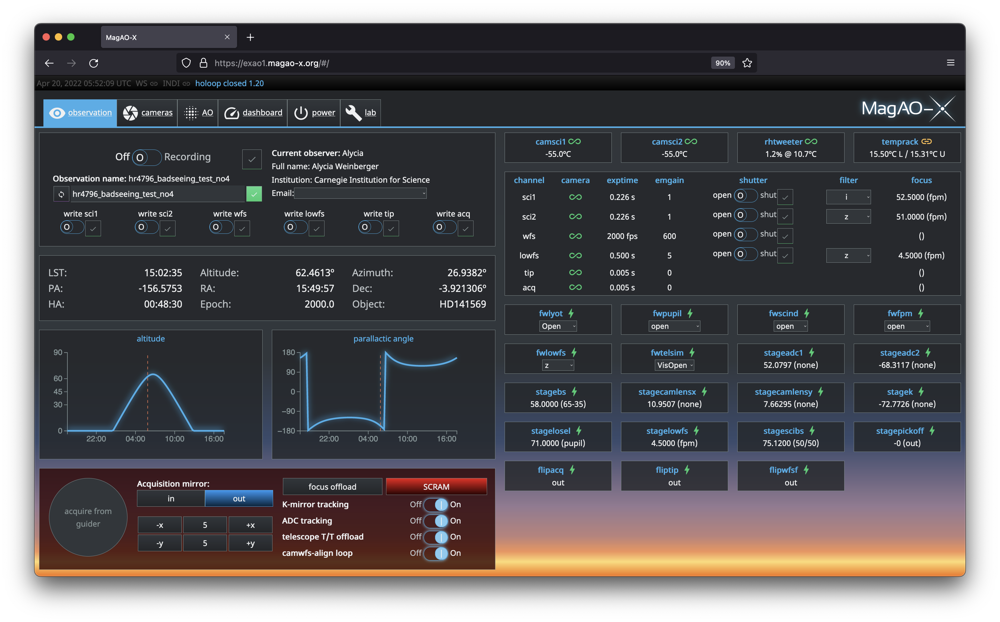

# sup

The MagAO-X web user interface in [Vue 3](https://vuejs.org/) (running in Vue 2 compatibility mode via `@vue/compat`) and async Python with [Starlette](https://www.starlette.io/). Built with [PurePyINDI2](https://github.com/xwcl/purepyindi2/).



The frontend is bundled with [Vite](https://vite.dev/), and the FITS/array viewer is [viewarr](https://github.com/joseph-long/viewarr-workspace), a Rust/WebAssembly module vendored as a git submodule. The submodule is the viewarr *workspace* — the library plus its other downstream consumers — and sup builds against the `viewarr/` library directory inside it.

## Development

Prerequisites: [uv](https://docs.astral.sh/uv/), node/npm, and a Rust toolchain with [wasm-pack](https://rustwasm.github.io/wasm-pack/installer/).

```bash
git clone --recurse-submodules git@github.com:magao-x/sup.git
cd sup
uv sync
```

`uv sync` installs sup in editable mode and runs the full frontend build: wasm-pack for `viewarr-workspace/viewarr/pkg/`, then `npm install` and `vite build` into `sup/static/`. (If you cloned without `--recurse-submodules`, run `git submodule update --init` first.)

Useful variations:

- `uv run sup` — start the server without activating the venv.
- `uv build` — build a wheel and sdist into `dist/`. The sdist carries the built `sup/static/` rather than the viewarr submodule, so a wheel built from it reuses those assets instead of rebuilding the frontend; rebuilding needs a git checkout with submodules.
- `SUP_SKIP_NPM_BUILD=1 uv sync` — skip the frontend build and reuse whatever is already in `sup/static/`.

The Makefile's `justjs` and `servejs` targets rebuild and live-serve just the JavaScript.

### Python

The Python code is a Starlette ASGI app. In MagAO-X, it's launched by a SystemD unit:

```
[Unit]
Description=MagAO-X Web UI
Requires=network.target
After=network.target

[Service]
User=xsup
WorkingDirectory=/home/xsup
ExecStart=/opt/conda/envs/sup/bin/sup

[Install]
WantedBy=default.target
```

(Note that for MagAO-X there's a `sup` env created in `/opt/conda` used by this app, currently on Python 3.13.)

The entry-point is a console command `sup` installed from `pyproject.toml`. It invokes the `WebInterface.run` class method in `core.py`, which invokes `WebInterface.main`, which calls `uvicorn.run`.

The config is read from `/opt/MagAOX/config/gui_sup.conf`, a TOML file. The effective config is shown with `sup --dump-config`:

```toml
layout = "magaox"
bind_host = "127.0.0.1"
bind_port = 8000
potemkin = false
debug_mode = true
batch_update_interval_sec = 0.2

[indi]
hostname = "localhost"
port = 7624
```

This is also the configuration used in the absence of a `gui_sup.conf` file. Configurable properties are mostly documented in the help:

```
% sup -h
usage: sup [-c CONFIG_FILE] [-h] [-v] [--dump-config] [vars ...]

positional arguments:
  vars                  Config variables set with 'key.key.key=value' notation

options:
  -c CONFIG_FILE, --config-file CONFIG_FILE
                        Path to config file, repeat to merge multiple, last one
                        wins for repeated top-level keys
  -h, --help            Print usage information
  -v, --verbose         Enable debug logging
  --dump-config         Dump final configuration state as TOML and exit

configuration keys:
  layout
      str
     (default: 'magaox')
  bind_host
      str
    Listening address (0.0.0.0 for all) (default: '127.0.0.1')
  bind_port
      int
    Listening TCP port (default: 8000)
  indi
      IndiConfig
     (default: IndiConfig(hostname='localhost', port=7624))
  indi.hostname
      str
    Hostname of INDI server (default: 'localhost')
  indi.port
      int
    Port number of INDI server (default: 7624)
  potemkin
      bool
    Whether to load a system snapshot for testing (disables connection
    to INDI server) (default: False)
  debug_mode
      bool
    Initialize Starlette framework in debug mode (default: True)
  batch_update_interval_sec
      float
    How often to emit a batch of updates over the websocket to
    connected clients (default: 0.2)
```

#### Audible alerts

Web UI users can opt in to hearing the alerts that the `audibleAlerts` xApp
(INDI device `maggieo_x`) plays in the control room. The device copies or
synthesizes every clip into `/tmp/audibleAlerts_cache` and publishes the path
relative to that directory as `maggieo_x.playback.file`; the browser notices
the property update over the existing INDI websocket and fetches the clip from
`/audible-alerts/clip/<file>`, so sup needs no speech synthesis of its own.
This does require sup to run on the same host as `audibleAlerts`, as the
service user (`xsup`) reading the device's cache directory.

Clips are content-addressed --- synthesized speech is named for a hash of its
text and voice --- so they are served `immutable` and a repeated utterance
plays straight from the browser cache. The `temp/` subdirectory, which holds
speech whose text was substituted at playback time, gets a short lifetime
instead.

Playback is off until a user turns it on with the speaker control in the status
bar (also on the Maggie-o X panel, with a volume slider). The opt-in is
per-browser and is remembered, but whether the browser will *play* anything is
a separate permission that no page can ask for: audio is allowed only after a
user interacts with the page, unless the user has allowed audio for the site in
their browser settings (Chrome calls it Sound, Firefox Autoplay, Safari
Auto-Play; Chrome also grants it on its own to sites where you play audio
often). On load, the player checks quietly --- with `navigator.getAutoplayPolicy`
where available, otherwise by trying to play silence --- so that someone whose
browser is withholding audio sees the speaker button marked rather than losing
the first alert. Clicking it starts playback for that session.

The player only listens: muting `maggieo_x` silences browsers along with
everything else, and a web listener can never unmute the control room.

One limit worth knowing: sup coalesces INDI updates into batches
(`batch_update_interval_sec`, 0.2 s by default) and sends each property's
current state rather than every value it passed through, so two utterances
announced inside one batch window would reach the browser as one. The device
sleeps for the length of each clip before announcing the next, so this does not
arise in practice.

#### Diagnosing alert latency

Every alert logs where its time went, so a report of "sometimes it lags" can be
answered with numbers. In the browser console:

```
[audible-alerts] a1b2c3d4e5.wav | announced 2026-10-27T17:38:04.717Z | delivery +0.03s over
this connection's best | queued 0.00s | clip fetched in 1.84s (182 kB over the network) |
playing 1.91s after the update arrived
```

The four measurements separate the four places time can go, because they have
different fixes:

- **delivery** --- how much later this update arrived than the fastest one this
  connection has managed. The server stamps each batch with its own clock, and
  while the offset between that clock and the browser's is unknown, it is
  constant, so growth in the difference is delay rather than skew. Large values
  mean updates are queueing between Chile and the browser.
- **queued** --- time spent waiting for an earlier clip to finish. Expected
  when alerts come in bursts, and not a fault.
- **clip** --- whether the audio came off the network or out of the browser
  cache, and how long it took. A first hearing of an utterance crosses the
  Atlantic; every later one should say `from browser cache`.
- **playing ... after the update arrived** --- the total, end to end.

`supAudibleAlerts.report()` in the console returns the last 50 of these plus a
delivery summary, and `supAudibleAlerts.text()` gives it as JSON to paste back.
A batch arriving more than a second late also logs a warning on its own, so a
slow connection is visible even when no alert is playing.

On the server side, `sup` logs a warning when sending one batch to one client
takes longer than `slow_send_warning_sec` (1 s by default), and when a client
falls so far behind that it is disconnected to resync
(`max_pending_updates_per_client`, 50 batches). Each client has its own
outbound queue, so a slow one costs only itself --- but it is still a sign
that someone's connection cannot keep up.

### Tests

`make test` runs both suites; each can be run on its own.

`uv run pytest` covers the clip endpoint --- cache lifetimes, revalidation, and
the refusal to serve anything outside the cache directory.

`cd frontend && npx playwright test` drives the whole stack in a real browser:
it starts `sup` and `tests/fake_audible_alerts_device.py` (a stand-in for the
`audibleAlerts` xApp that publishes `maggieo_x.playback` and generates clips to
serve), then checks that alerts stay silent until enabled, play when the device
announces them, come from cache when repeated, queue when they overlap, and
survive a reload. It runs twice: once in a browser that allows audio only after
an interaction, and once in one that allows it outright, which is how the two
halves of the permission story above get covered. The frontend must be built
first (`npm run build`, or use `make test-browser`).

That fake device is useful outside the tests too --- `make fake-audible-alerts`
runs it standalone, so the web UI's alert playback can be exercised without a
MagAO-X instrument:

```bash
make fake-audible-alerts   # INDI on 17624, control on 17625
uv run sup indi.port=17624 audible_alerts_cache_root=/tmp/sup-fake-audible-alerts
curl -X POST 'http://127.0.0.1:17625/emit?file=a1b2c3d4e5.wav'
```

### JavaScript

Most interesting stuff is in `*.vue` single-file component files, which combine HTML with JavaScript and stylesheet information.

Visual Studio Code with the official Vue extension improves development considerably.

If you use `make servejs`, you launch the bundler in live-reload mode, which saves time. The "live" part of live-reloading is not an easy thing to do in general, so you probably need to reload the page on changes. You will *also* need the Python server process running on port 8000 for the connection to MagAO-X to work. (You can use the `sup` command to launch it, and port 8000 is default.)

The entry point is the `index.html` file, which loads `src/index.js`, which displays `App.vue` as its root component. There is a second entry point, `viewer.html`/`src/viewer.js`, for the standalone FITS viewer.

WebSocket connection / reconnection is kind of hard to find, but it's in the `mounted` hook for the `common.js` mixin used in `index.js`. (It is common *not* to all components, but to all *top-level* components, of which there is currently one non-trivial example.)
